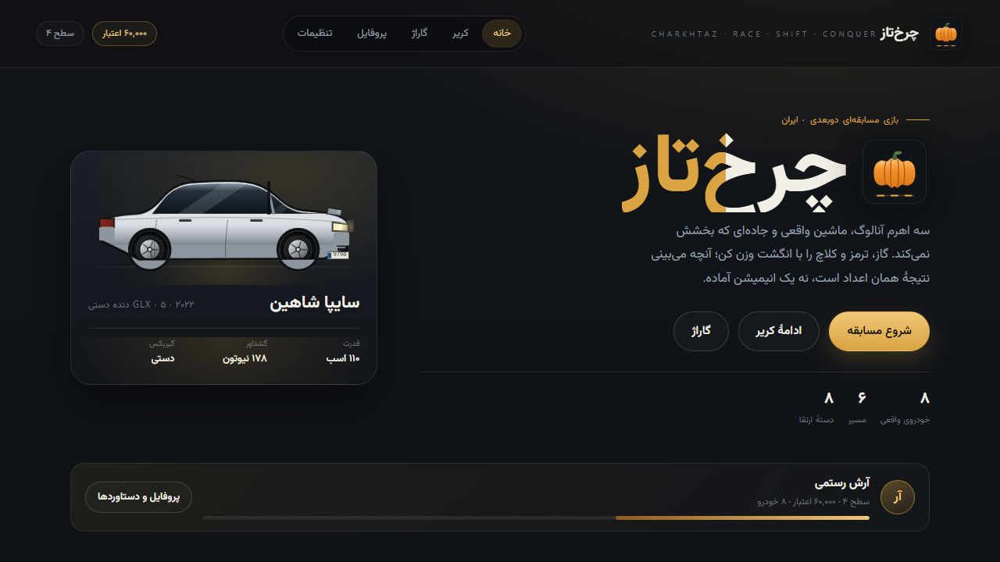
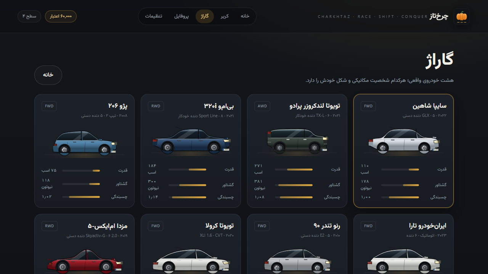
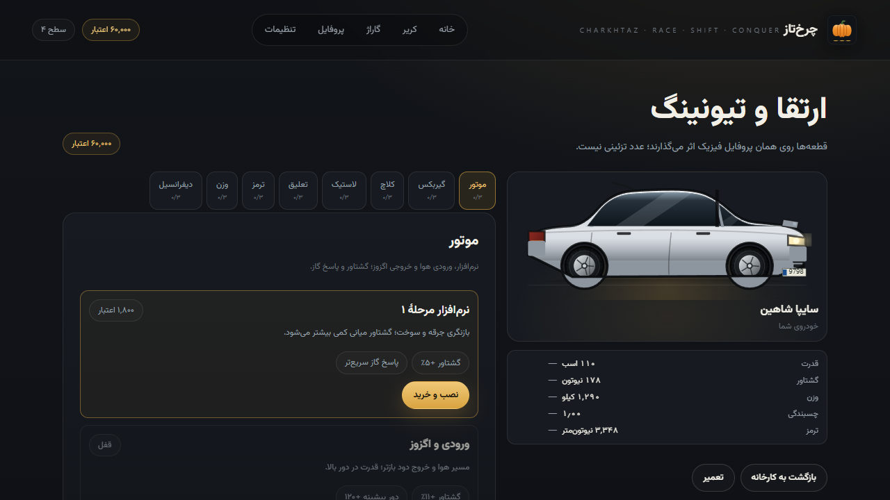
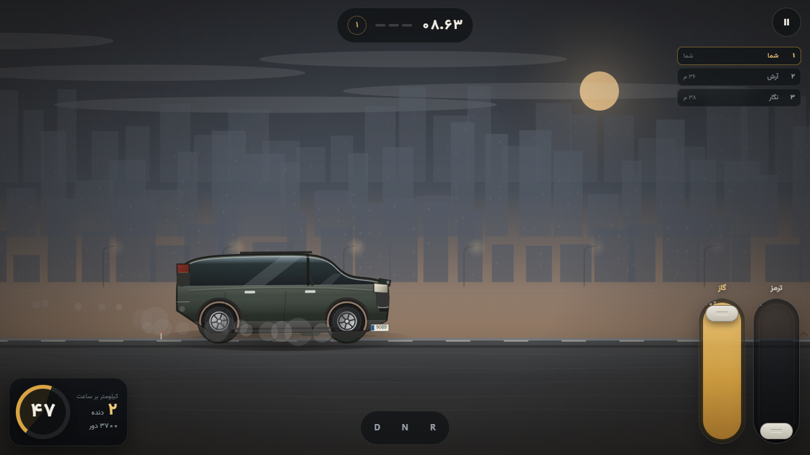
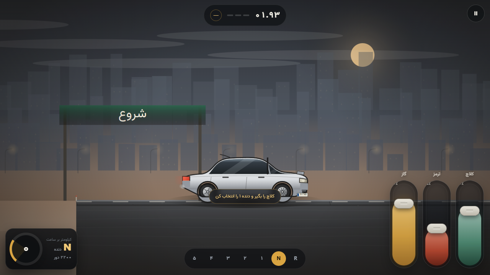
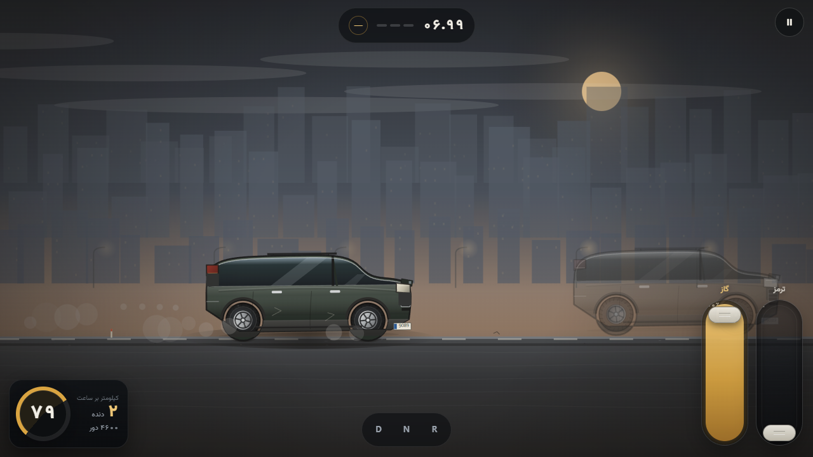
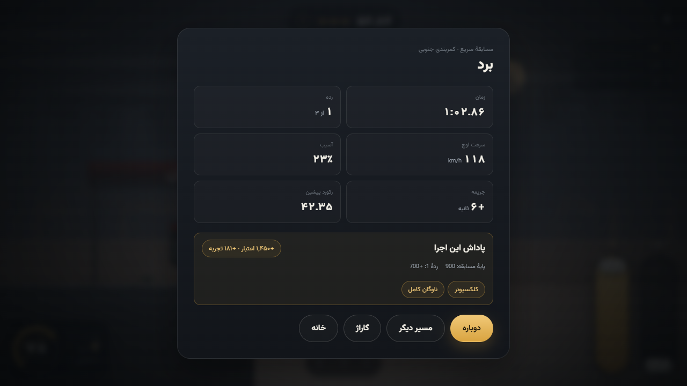
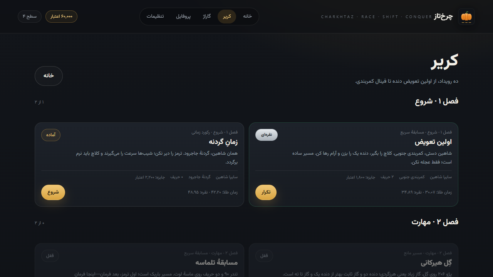

# چرخ‌تاز · CHARKHTAZ

**RACE · SHIFT · CONQUER**

A Persian-first, offline, **2D side-view physics racing and obstacle-trial** game
for Android (Capacitor) and the web. Real production cars, a custom
vehicle-dynamics layer on top of Planck.js, and three vertical analogue pedals —
throttle, brake and clutch — as the core control mechanic.

Canonical repository: `github.com/khiyarusa/charkhtaz` · branch `main`.

> **Status: v0.3.0 — vehicle-art overhaul, playable, not store-ready.**
> Eight cars now use independent, measured side-elevation blueprints
> (`src/vehicles/art/`) instead of category templates, drawn by one layered
> renderer in every screen. Career, AI, ghost, trials, upgrades, audio, damage and
> saves are unchanged and tested. Device-level Android verification is still
> **not** done; see [Status](#status).

## Quick start

```bash
npm ci
npm run dev        # http://localhost:5173
npm test           # Vitest: physics, roster, upgrades, economy, ghost, AI, saves
npm run build      # typecheck + production bundle
```

Android shell:

```bash
npm run build
npx cap sync android
# then open android/ in Android Studio, or let CI build it
```

## Controls

| Input | Action |
| --- | --- |
| Drag a vertical slider **up** | more throttle / brake / clutch |
| Release a slider | spring return, fed into the simulation |
| `W` / `S` | throttle / brake (desktop QA; the key ramps like a foot) |
| `C` | clutch |
| `1`–`6`, `0` | select gear / neutral (manual needs clutch) |
| `R` | respawn at the last checkpoint (+3 s) |
| `E` | restart engine |
| `Esc` | pause |

Manual cars start in neutral. Pull the clutch slider up, select 1st, then release
the clutch progressively; an abrupt release at low rpm will stall the engine.
Automatic cars use R / N / D and a torque-converter (or CVT) model with lock-up.

## What is in this build

- **Physics** — Planck.js rigid bodies: chassis + two independently simulated
  wheel bodies on wheel joints, mass-based spring/damper suspension with travel
  limits, contact-patch tyre forces, weight transfer, jumps and landings. Fixed
  60 Hz step with a bounded accumulator and render interpolation.
- **Powertrains** — manual engine/clutch/gearbox with a bite curve, clutch
  interlock and mechanical over-rev; torque-converter automatic with lock-up,
  throttle-aware shifting and a wheelspin-aware schedule. One documented torque
  path (`docs/VEHICLE_PHYSICS.md`).
- **Surfaces** — dry/wet asphalt, dirt, gravel, sand, mud, rock, wood; friction
  and rolling resistance differ and change braking and traction.
- **Cars** — eight models, each with its own measured side-elevation blueprint
  (outline, glasshouse, lamps, grille, door cuts, trim and wheel spec): Saipa
  Shahin 1.5T, Peugeot 206 Type 2, IKCO Tara, Renault Tondar 90, Toyota Corolla
  E210, BMW 320i G20, Toyota Land Cruiser Prado 150, Mazda MX-5 ND. Data and
  confidence in [`docs/VEHICLE_DATA_SOURCES.md`](docs/VEHICLE_DATA_SOURCES.md) and
  [`docs/vehicle-art/VEHICLE_REFERENCE_LEDGER.md`](docs/vehicle-art/VEHICLE_REFERENCE_LEDGER.md).
- **Routes** — six data-driven tracks across mountain, desert, forest and urban
  biomes, with ramps, whoops, boulders, logs, tyre stacks and planks.
- **Modes** — quick race (AI opponents), time trial (best-run ghost), obstacle
  trial (score + bronze/silver/gold) and free practice.
- **Career** — ten offline events in five chapters, chained unlocks, medals and
  credit/XP rewards with duplicate-claim protection.
- **Upgrades** — eight categories (engine, gearbox, clutch, tyres, suspension,
  brakes, weight, differential), buy/install/remove/reset, compatibility rules,
  cosmetics, and a live before/after comparison derived from the tuned profile the
  physics actually consumes.
- **Damage** — impacts raise a staged visual damage level, reduce grip/engine
  health and persist as car condition; the garage repairs it for credits.
- **Audio** — original procedural WebAudio: engine layers by rpm/throttle/load
  and engine archetype, tyre rolling noise by surface, wheelspin, wind, gear
  shifts, impacts, checkpoints, UI and finish fanfare. No sampled third-party
  audio.
- **Brand** — original pumpkin emblem family (SVG), Persian and Latin lockups,
  app icons, splash and in-game marks.
- **UI** — genuine RTL Persian interface with bundled Vazirmatn, garage with live
  car previews, profile, career map, upgrades, settings, HUD, pause and results.
- **Save** — versioned localStorage schema with legacy migration and corrupt-save
  recovery. Settings, cars, upgrades, condition, best times, medals and ghosts
  persist offline.

## Screenshots

Real captures from the running build (1280×720, headless Edge 157, DPR 1):

| | |
| --- | --- |
|  |  |
|  |  |
|  |  |
|  |  |

The full set, including every car, every upgrade category, settings and both
transmission HUDs, is in [`docs/visual-qa/v0.2.0/screenshots`](docs/visual-qa/v0.2.0/screenshots)
with the capture report in `docs/visual-qa/v0.2.0/report.json`.

## Status

| Area | State | Evidence |
| --- | --- | --- |
| Vehicle physics | Implemented, tested | `src/physics/vehicle.test.ts`, `src/game/render-interpolation.test.ts` |
| Manual + automatic drivetrains | Implemented, tested | same suites + `docs/VEHICLE_PHYSICS.md` |
| Route completion | Verified under autonomous control on all six routes | `src/tracks/completion.test.ts` |
| Three analogue sliders | Implemented, multi-touch verified in browser | `report.json` → 80 / 45 / 70 simultaneously |
| Persian RTL UI | Implemented | screenshot set + `docs/PERSIAN_COPY_GUIDE.md` |
| AI opponents | Implemented, tested | `src/racing/ai.test.ts`, race screenshots |
| Ghost replay | Implemented, tested | `src/racing/ghost.test.ts`, `20-ghost-replay.png` |
| Career + economy | Implemented, tested | `src/career/economy.test.ts` |
| Obstacle-trial scoring | Implemented, tested | `src/career/economy.test.ts` (par-based scoring) |
| Upgrades | Implemented, tested | `src/vehicles/upgrades.test.ts` |
| Save + migration | Implemented, tested | `src/save/storage.test.ts` |
| Audio | Implemented (procedural) | `src/audio/*.test.ts` |
| Android package | CI-built debug APK + unsigned AAB, published | [v0.2.0 release](https://github.com/khiyarusa/charkhtaz/releases/tag/v0.2.0) · [evidence](docs/BUILD-EVIDENCE.md) |
| Physical device multi-touch QA | **Pending** — no phone attached | browser multi-touch only |
| Release signing | **Pending** — debug APK only; keystore is not in the repo | `docs/BUILD-EVIDENCE.md` |

Honest limits:

- Physics is 2D rigid-body only. There is no lateral cornering, yaw or steering
  axis; the car is driven by throttle, brake and clutch.
- Obstacle heights are capped below the smallest wheel radius, and authored
  "gaps" are shallow ditches, because a side-view car with no steering cannot be
  guaranteed to clear a hole. This is a deliberate design decision, documented in
  `docs/VEHICLE_PHYSICS.md`.
- The Android build was not produced in this environment (no Android SDK). The
  workflow is unchanged and runs on GitHub Actions.

## Architecture

```
src/
  core/        math, RNG, formatting, build identity
  physics/     Planck terrain + vehicle assembly (chassis, wheels, suspension)
  vehicles/    engine, clutch, gearbox, tyre, drivetrains, car data, upgrades
  tracks/      track types, authoring builder, six route definitions
  controls/    three vertical analogue sliders
  render/      canvas renderer, biome palettes, model-specific vehicle art
  game/        fixed-step scene, timing, checkpoints, respawn, effects
  racing/      AI controller, ghost capture/replay
  career/      events, medals, scoring, economy, achievements
  audio/       procedural engine/tyre/effect graph
  ui/          Persian RTL screens, HUD, design system
  save/        versioned persistence + migration
```

- World units are metres; the renderer is the only place pixels exist.
- Planck is the single physics authority; the joint motor is disabled and
  drivetrain torque reaches the ground through the documented tyre model only.
- Tracks are data; terrain collision and terrain art come from the same polyline.

## CI

| Workflow | Trigger | Does |
| --- | --- | --- |
| `.github/workflows/web.yml` | push / PR | `npm ci`, tests, typecheck + build, uploads `dist` |
| `.github/workflows/android.yml` | tag `v*` / manual | builds debug APK + unsigned release AAB, attaches to the GitHub release |

The debug APK is installable. The AAB is **unsigned** on purpose: signing keys
must never be committed. Add a keystore through repository secrets to produce a
store-ready build.

## Documentation

- [`docs/SPEC-V1.md`](docs/SPEC-V1.md) — product specification
- [`docs/VEHICLE_PHYSICS.md`](docs/VEHICLE_PHYSICS.md) — simulation authority and limits
- [`docs/VEHICLE_DATA_SOURCES.md`](docs/VEHICLE_DATA_SOURCES.md) — data provenance
- [`docs/UPGRADE_SYSTEM.md`](docs/UPGRADE_SYSTEM.md) — parts, compatibility, economy
- [`docs/ART_BIBLE.md`](docs/ART_BIBLE.md) — brand, palette, sprite rules
- [`docs/ASSET_LICENSES.md`](docs/ASSET_LICENSES.md) — every shipped asset and its licence
- [`docs/PERSIAN_COPY_GUIDE.md`](docs/PERSIAN_COPY_GUIDE.md) — voice, terminology, copy audit
- [`docs/QA-VISUAL.md`](docs/QA-VISUAL.md) — screenshot evidence and defects fixed
- [`docs/QA-REGRESSION.md`](docs/QA-REGRESSION.md) — tests, touch, performance
- [`docs/BUILD-EVIDENCE.md`](docs/BUILD-EVIDENCE.md) — builds, artifacts, limits
- [`docs/REQUIREMENT-CLOSURE.md`](docs/REQUIREMENT-CLOSURE.md) — requirement matrix
- [`AGENTS.md`](AGENTS.md) — working rules for contributors and agents

## Non-negotiables

1. True 2D only. No 3D engines, models or physics.
2. Three vertical analogue sliders are the control mechanic; never replace them
   with tap buttons.
3. Persian-first, real RTL, locally bundled Vazirmatn, no runtime CDN.
4. Offline-first: no remote assets, fonts or scripts at runtime.
5. Real model names with recorded sources; estimates are labelled as estimates.
6. No secrets, keystores or tokens in the repository. No force-push.

## License

Code and original artwork: not yet licensed for redistribution. Vehicle names are
factual identifiers; no manufacturer endorsement is implied and no logos are
reproduced. Vazirmatn is used under the SIL Open Font License (see
`public/assets/fonts/OFL.txt`).
